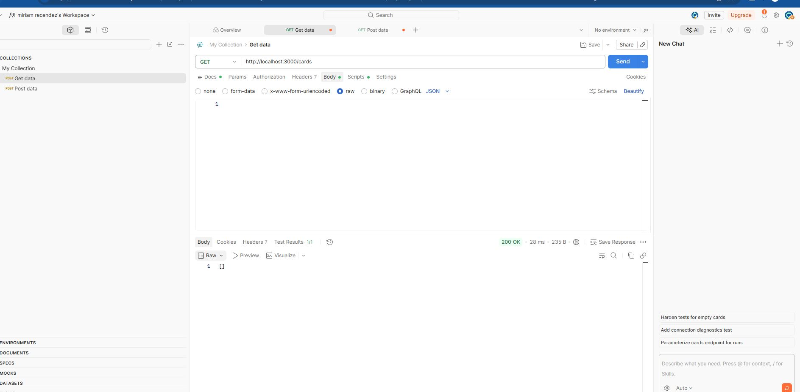
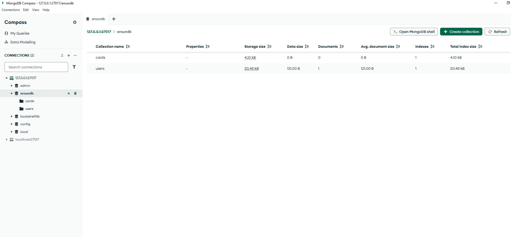

# TripleTen — web_project_around_express

## Descripción del proyecto

Este proyecto consiste en el desarrollo de una API REST para la aplicación
"Alrededor de los EE. UU.".

La API está desarrollada con Node.js, Express, TypeScript, MongoDB y Mongoose.
Permite gestionar usuarios y tarjetas, incluyendo la creación, consulta,
actualización y eliminación de información almacenada en una base de datos
MongoDB.

El servidor se ejecuta en el puerto 3000.

## Funcionalidad

Actualmente la API permite:

- Obtener la lista completa de usuarios.
- Obtener un usuario mediante su ID.
- Obtener los datos del usuario actual.
- Crear nuevos usuarios.
- Actualizar el perfil del usuario actual.
- Actualizar el avatar del usuario actual.
- Obtener todas las tarjetas.
- Crear nuevas tarjetas.
- Eliminar tarjetas mediante su ID.
- Dar like a una tarjeta.
- Quitar el like de una tarjeta.
- Calcular el campo `isLiked` de acuerdo con el usuario actual.
- Manejar errores de forma centralizada.
- Devolver un error 400 cuando se proporcionan datos o IDs inválidos.
- Devolver un error 404 cuando no se encuentra un usuario o una tarjeta.
- Devolver un error 500 cuando ocurre un error inesperado en el servidor.

## Tecnologías y técnicas utilizadas

- Node.js
- Express
- TypeScript
- MongoDB
- Mongoose
- ES Modules
- API REST
- Programación asíncrona con `async/await`
- Middleware de Express
- Manejo centralizado de errores
- Validación de datos con Mongoose
- ESLint
- Prettier
- EditorConfig
- Git y GitHub
- Postman para probar los endpoints

## Base de datos

Los usuarios y las tarjetas se almacenan en MongoDB.

La aplicación utiliza Mongoose para definir los esquemas y modelos de los
usuarios y las tarjetas, así como para realizar operaciones de lectura,
creación, actualización y eliminación de documentos.

## Rutas de la API

### Usuarios

`GET /users`

Devuelve todos los usuarios.

`GET /users/:id`

Devuelve un usuario mediante su ID.

`POST /users`

Crea un nuevo usuario.

`GET /users/me`

Devuelve los datos del usuario actual.

`PATCH /users/me`

Actualiza el nombre y la descripción del usuario actual.

`PATCH /users/me/avatar`

Actualiza el avatar del usuario actual.

### Tarjetas

`GET /cards`

Devuelve todas las tarjetas.

`POST /cards`

Crea una nueva tarjeta.

`DELETE /cards/:id`

Elimina una tarjeta mediante su ID.

`PUT /cards/:id/likes`

Agrega el like del usuario actual a una tarjeta.

`DELETE /cards/:id/likes`

Elimina el like del usuario actual de una tarjeta.

## Manejo de errores

La API utiliza un middleware centralizado para gestionar errores.

Los principales códigos de respuesta son:

- `400` — datos inválidos o ID con formato incorrecto.
- `404` — usuario, tarjeta o recurso no encontrado.
- `500` — error inesperado del servidor.

## Capturas de pantalla

### Prueba de la API con Postman

### Base de datos en MongoDB Compass

